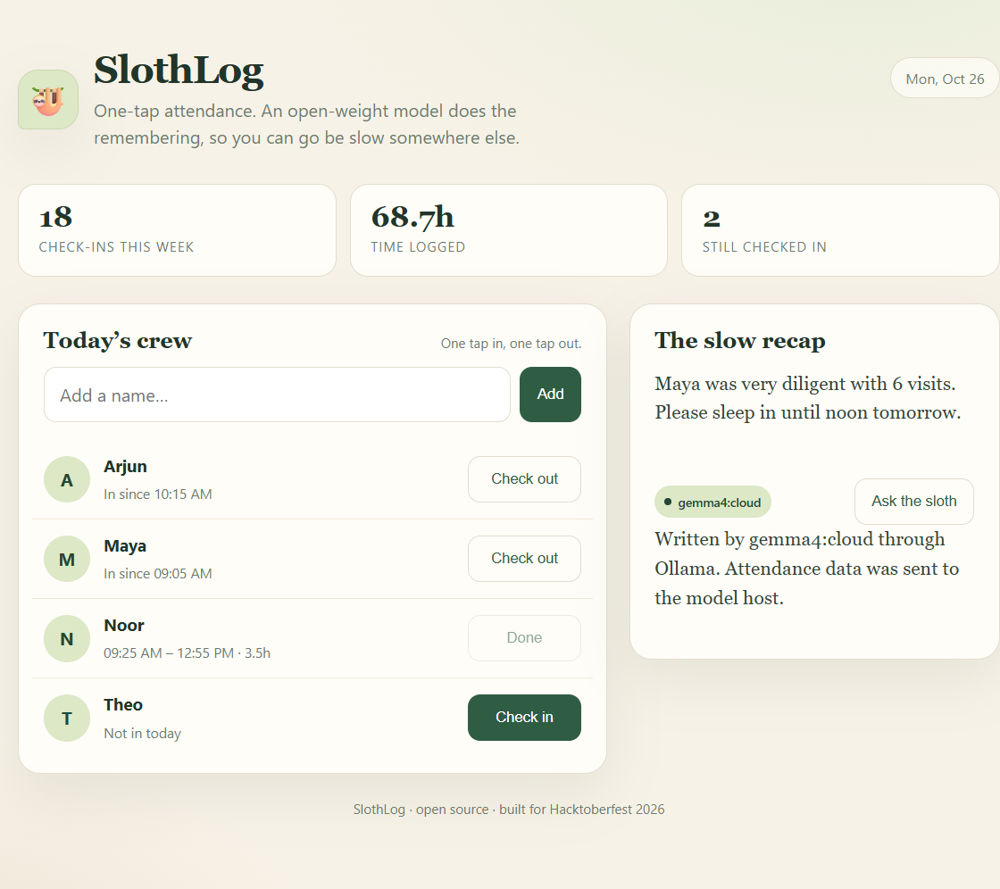

# SlothLog 🦥

**One-tap attendance, recapped by an open-weight model.**

SlothLog is a tiny attendance log for small teams, classes, or co-working days. You add a name, tap once to check in, tap once to check out. At the end of the week, a local Ollama model turns the log into two calm sentences and one suggestion for being a little lazier tomorrow.

Built for **Hacktoberfest Open-Source AI Challenge: Week 3 — Slow and Steady**.



## What it does

- Tracks today's check-ins and check-outs with one tap.
- Shows weekly check-ins, total time logged, and who is still in.
- Sends a compact attendance summary to an open-weight model through Ollama.
- Falls back to a built-in recap when Ollama is not running, so the app never breaks.
- Keeps everything in a single local SQLite file (`slothlog.db`).

## Run it

Requires [Bun](https://bun.sh) and (optionally) [Ollama](https://ollama.com).

```bash
bun start
# open http://localhost:3000
```

Optional sample data:

```bash
bun run seed
```

To use the AI recap, have Ollama running with any open-weight model:

```bash
ollama pull gemma3:270m   # or any model you already have
bun start
```

If the model is named `:cloud`, the UI says the data went to the model host. A normal local model keeps it on your machine.

Configure with environment variables:

| Variable | Default | Purpose |
| --- | --- | --- |
| `PORT` | `3000` | HTTP port |
| `OLLAMA_URL` | `http://127.0.0.1:11434` | Ollama endpoint |
| `OLLAMA_MODEL` | first installed model | Model name |

## How it works

```text
public/index.html  →  one page, vanilla JS, no build step
server.js          →  Bun.serve + bun:sqlite + Ollama call
slothlog.db        →  local attendance data (gitignored)
```

There are no runtime dependencies. Bun ships the HTTP server and SQLite driver, so the whole app is three small files.

The recap prompt gets the last seven days of check-ins as compact text and asks for two sentences under 45 words. The request goes to `POST /api/generate` on the Ollama API. Nothing else leaves the machine.

## Why open innovation matters here

Attendance is boring, personal data. A closed SaaS would ask for an account, a subscription, and a copy of everyone's schedule. SlothLog instead runs on a laptop, stores its own SQLite file, and uses an open-weight model the owner can choose, swap, or run offline. The AI is not a rented feature bolted on top; it is the part that turns a dry table into a recap a human would actually read.

The same property makes it cheap to keep alive: one Bun process, one file, no per-token bill, no vendor deciding the model should change.

## API

| Method | Path | Body |
| --- | --- | --- |
| `GET` | `/api/state` | — |
| `POST` | `/api/people` | `{"name":"Maya"}` |
| `POST` | `/api/checkin` | `{"personId":1}` |
| `POST` | `/api/checkout` | `{"personId":1}` |
| `POST` | `/api/recap` | — |

## License

MIT. See [LICENSE](LICENSE).
